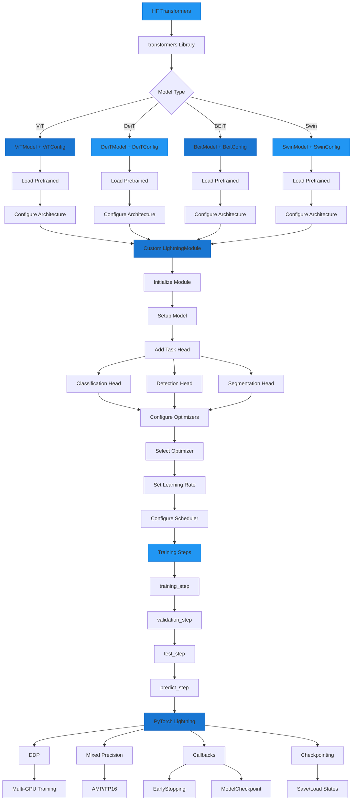

# HuggingFace Transformers Integration

AutoTimm can work alongside HuggingFace Transformers vision models (ViT, DeiT, BEiT, Swin, etc.) with PyTorch Lightning. This guide shows you how to use these models directly without Auto classes for full control and compatibility.

## Direct Model Integration



## Overview

**Key Finding: You don't need Auto classes!** All HuggingFace vision models can be used directly with specific model classes for better control and type safety.

```python
# :material-check-circle: RECOMMENDED: Specific model classes directly
from transformers import (
    ViTModel, ViTConfig, ViTImageProcessor,  # Vision Transformer
    DeiTModel, DeiTConfig,                   # DeiT
    BeitModel, BeitConfig,                   # BEiT
    SwinModel, SwinConfig,                   # Swin
)

# :material-close-circle: NOT REQUIRED: Auto classes
from transformers import AutoModel, AutoImageProcessor, AutoConfig
```

## Compatibility

All PyTorch Lightning features work seamlessly with HuggingFace vision models:

- :material-check-circle: Manual model creation and pretrained loading
- :material-check-circle: Lightning training, validation, testing
- :material-check-circle: Checkpoint save/load
- :material-check-circle: Distributed training (DDP)
- :material-check-circle: Mixed precision (FP16/BF16)
- :material-check-circle: All Lightning callbacks
- :material-check-circle: Gradient computation and optimization

## Quick Start

### Manual Model Creation

```python
import pytorch_lightning as pl
import torch
from transformers import ViTModel, ViTConfig

class ViTClassifier(pl.LightningModule):
    def __init__(self, num_classes=10):
        super().__init__()

        # Create config directly (no AutoConfig)
        config = ViTConfig(
            hidden_size=768,
            num_hidden_layers=12,
            num_attention_heads=12,
            image_size=224,
            patch_size=16,
        )

        # Create model directly (no AutoModel)
        self.vit = ViTModel(config)

        # Add classifier head
        self.classifier = torch.nn.Linear(config.hidden_size, num_classes)

    def forward(self, pixel_values):
        outputs = self.vit(pixel_values=pixel_values)
        logits = self.classifier(outputs.pooler_output)
        return logits

    def training_step(self, batch, batch_idx):
        images, labels = batch
        logits = self(images)
        loss = torch.nn.functional.cross_entropy(logits, labels)
        return loss

    def configure_optimizers(self):
        return torch.optim.AdamW(self.parameters(), lr=1e-4)

# Create and train
model = ViTClassifier(num_classes=10)
trainer = pl.Trainer(max_epochs=10)
trainer.fit(model, datamodule=data)
```

### Load Pretrained Model

```python
class PretrainedViTClassifier(pl.LightningModule):
    def __init__(self, num_classes=1000):
        super().__init__()

        # Load pretrained directly (no AutoModel)
        self.vit = ViTModel.from_pretrained(
            "google/vit-base-patch16-224-in21k"
        )

        # Add custom classifier
        self.classifier = torch.nn.Linear(
            self.vit.config.hidden_size,
            num_classes
        )

    def forward(self, pixel_values):
        outputs = self.vit(pixel_values=pixel_values)
        return self.classifier(outputs.pooler_output)

model = PretrainedViTClassifier(num_classes=100)
```

### Manual Image Preprocessing

```python
from transformers import ViTImageProcessor
from PIL import Image

# Create processor directly (no AutoImageProcessor)
processor = ViTImageProcessor(
    size={"height": 224, "width": 224},
    do_normalize=True,
    image_mean=[0.485, 0.456, 0.406],  # ImageNet mean
    image_std=[0.229, 0.224, 0.225],   # ImageNet std
)

# Process image
img = Image.open("image.jpg")
inputs = processor(images=img, return_tensors="pt")

# Use with model
pixel_values = inputs["pixel_values"]
outputs = model(pixel_values)
```

## Supported Models

All HuggingFace vision transformer models work without Auto classes:

### Vision Transformer (ViT)

```python
from transformers import ViTModel, ViTConfig
model = ViTModel(ViTConfig(...))
# or
model = ViTModel.from_pretrained("google/vit-base-patch16-224")
```

### DeiT (Data-efficient ViT)

```python
from transformers import DeiTModel, DeiTConfig
model = DeiTModel(DeiTConfig(...))
```

### BEiT

```python
from transformers import BeitModel, BeitConfig
model = BeitModel(BeitConfig(...))
```

### Swin Transformer

```python
from transformers import SwinModel, SwinConfig
model = SwinModel(SwinConfig(...))
```

### ConvNeXT

```python
from transformers import ConvNextModel, ConvNextConfig
model = ConvNextModel(ConvNextConfig(...))
```

## Advanced Features

### Distributed Training

```python
# Multi-GPU training works perfectly
trainer = pl.Trainer(
    max_epochs=100,
    accelerator="gpu",
    devices=4,
    strategy="ddp",
)

# HF models work seamlessly with DDP
trainer.fit(model, datamodule=data)
```

### Mixed Precision Training

```python
trainer = pl.Trainer(
    max_epochs=100,
    precision="16-mixed",  # FP16
)

# Works with HF models
trainer.fit(model, datamodule=data)
```

### Checkpointing

```python
# Save checkpoint
trainer = pl.Trainer(
    max_epochs=100,
    callbacks=[
        pl.callbacks.ModelCheckpoint(
            monitor="val/acc",
            mode="max",
            save_top_k=1,
        )
    ]
)
trainer.fit(model, datamodule=data)

# Load checkpoint
loaded_model = ViTClassifier.load_from_checkpoint(
    "checkpoints/best.ckpt"
)
```

## Common Patterns

### Pattern 1: Freeze Backbone, Train Head

```python
class ViTClassifier(pl.LightningModule):
    def __init__(self):
        super().__init__()
        self.vit = ViTModel.from_pretrained("google/vit-base-patch16-224")

        # Freeze backbone
        for param in self.vit.parameters():
            param.requires_grad = False

        # Only train classifier
        self.classifier = torch.nn.Linear(768, num_classes)
```

### Pattern 2: Two-Stage Training

```python
# Stage 1: Train head only
model = ViTClassifier()
for param in model.vit.parameters():
    param.requires_grad = False

trainer.fit(model, max_epochs=10)

# Stage 2: Fine-tune all
for param in model.vit.parameters():
    param.requires_grad = True

model.lr = 1e-5  # Lower LR
trainer.fit(model, max_epochs=20)
```

## Integration with AutoTimm

AutoTimm uses the `timm` library, not `transformers`. They are complementary:

- **timm**: PyTorch Image Models (CNN and ViT backbones via AutoTimm)
- **transformers**: HuggingFace Transformers (NLP and Vision models)
- **huggingface_hub**: Hub client for downloading models

You can use **both** in the same project:

```python
import autotimm as at  # recommended alias

# AutoTimm with timm backbones
model1 = at.create_backbone("resnet50")

# AutoTimm with HF Hub timm models
model2 = at.create_backbone("hf-hub:timm/resnet50.a1_in1k")

# Direct HF transformers usage
from transformers import ViTModel
model3 = ViTModel.from_pretrained("google/vit-base-patch16-224")

# All work with PyTorch Lightning!
```

## Why Avoid Auto Classes?

### Advantages of Direct Approach

1. **Full Control**: Explicitly configure every aspect of the model
2. **Type Safety**: Better IDE autocomplete and type hints
3. **Transparency**: No magic, clear what's happening
4. **Customization**: Easy to modify and extend
5. **Performance**: No abstraction overhead
6. **Debugging**: Easier to debug and understand

### When Auto Classes Might Be Useful

- **Multi-model pipelines**: When working with many different model types
- **Dynamic model selection**: When model type is determined at runtime
- **Quick prototyping**: When you want to quickly try different models

**For production and full control, direct classes are recommended.**

## Troubleshooting

For HuggingFace Transformers integration issues, see the [Troubleshooting - HuggingFace](../../troubleshooting/integration/huggingface.md) including:

- Model expects 'pixel_values' keyword argument
- Model is slow
- Checkpoint loading fails

## Performance Considerations

### Memory Usage

| Model | Parameters | Memory (FP32) | Memory (FP16) |
|-------|-----------|---------------|---------------|
| ViT-Tiny | 5M | ~20 MB | ~10 MB |
| ViT-Small | 22M | ~88 MB | ~44 MB |
| ViT-Base | 86M | ~344 MB | ~172 MB |
| ViT-Large | 307M | ~1.2 GB | ~600 MB |

**Tip**: Use FP16 training to reduce memory:

```python
trainer = pl.Trainer(precision="16-mixed")
```

### Speed Optimization

```python
# 1. Use compiled model (PyTorch 2.0+)
model = torch.compile(model)

# 2. Use gradient checkpointing for large models
model.vit.gradient_checkpointing_enable()

# 3. Use efficient attention
config.attention_probs_dropout_prob = 0.0
```

## Resources

- [Example: HF Direct Models with Lightning](https://github.com/Noctillio-Ai/AutoTimm/blob/main/examples/huggingface/hf_direct_models_lightning.py)
- [HuggingFace Transformers Docs](https://huggingface.co/docs/transformers)
- [PyTorch Lightning Docs](https://lightning.ai/docs/pytorch)
